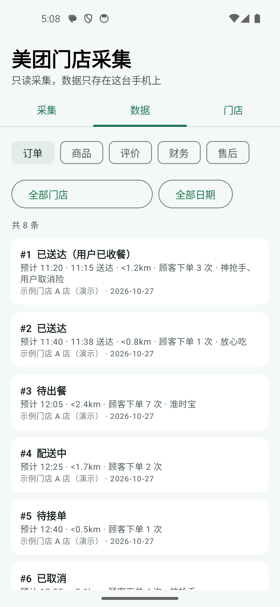
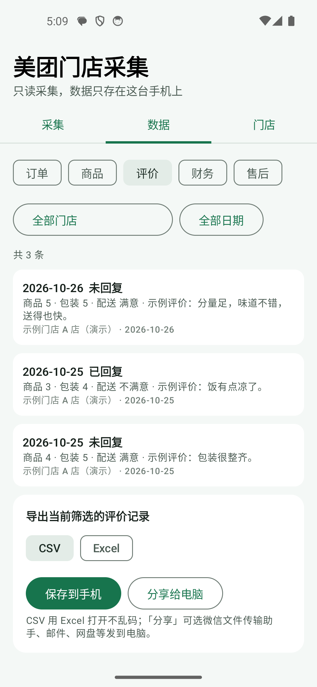
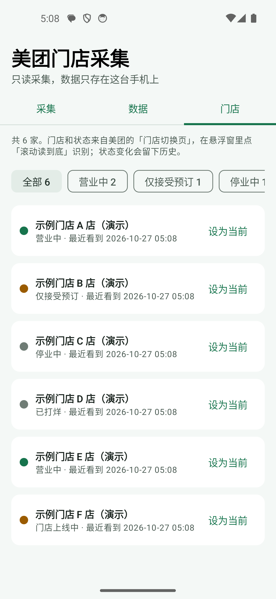
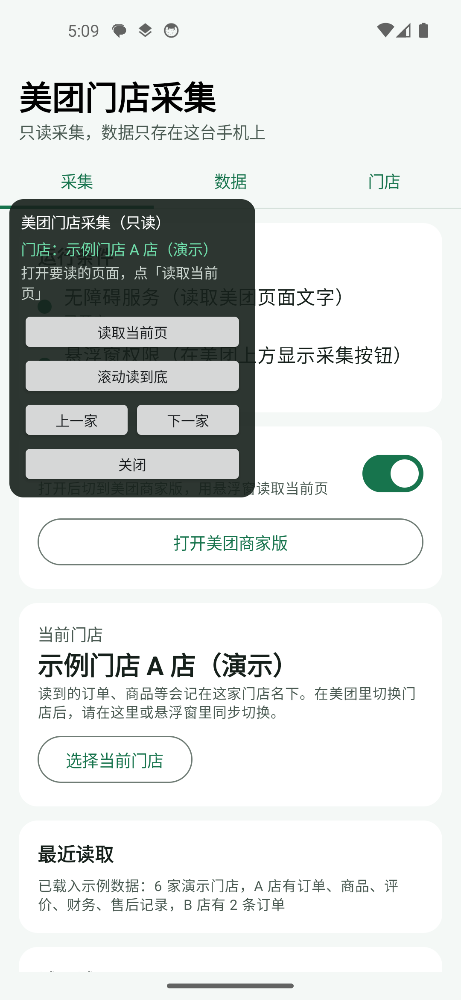

# 美团门店数据采集（安卓）

> 篝火出品 · 收录于篝火 App 应用区。本工具开源，全部工具见 [toolkit-hub](https://github.com/campfire-code/toolkit-hub)。

装在安卓手机上的**只读**采集工具：你在美团商家版里打开订单、商品、评价、财务、售后或门店切换页，用悬浮窗点「读取当前页」或「滚动读到底」，本工具通过无障碍服务把页面上显示的文字解析成记录，存进手机本机的 SQLite，自动去重；可以按门店、类型、日期查看，导出 CSV 或 Excel，保存到手机或分享给电脑。原生安卓应用，**不申请网络权限**，数据不上传。

<p>




</p>

> 截图是模拟器里的**示例**：门店和数据全部虚构（门店名带「演示」），没有打开真实的美团 App。

## 风险与免责

**使用前请先读完这一节。**

- **本工具用无障碍服务自动读取第三方 App（美团商家版）的页面，可能违反平台的使用规则**，账号是否会被风控、警告或限制，本工具无法判断也无法保证。是否使用、使用频率，由你自己决定并自行承担后果。
- **只读取你有权访问的门店数据。** 不要用来读取不属于你、或你未获授权管理的门店。
- 无障碍权限能读取屏幕上显示的内容。本工具在服务配置里把读取范围限定为美团商家版一个应用（见下面「隐私说明」），但这只是在配置层面的限制，你仍应只在自己的设备上开启。
- **只读**：不点击页面里的任何按钮，不接单、不出餐、不退款、不申诉、不改价、不上下架、不回复评价、不联系顾客。唯一的手势是「向上翻页」，用来读长列表。
- 页面结构随美团版本和门店类型而变，解析可能读错或读不全；财务、金额等数据请以美团后台为准，不要直接用于结算。
- 不做：验证码识别或绕过、绕过平台风控、云端同步、统计上报、自动切换门店、自动调整点金出价等任何写操作。

## 能做什么

| 页面 | 读到的内容 |
|---|---|
| 门店切换页 | 门店名、门店状态（营业中、仅接受预订、停业中、已打烊、已下线、门店上线中）；状态变化留历史 |
| 订单列表 | 序号、状态、预计送达与送达时间、出餐用时、距离、顾客下单次数、服务标签；展开的卡片还有订单号、预计收入 |
| 商品管理 | 商品名、月售、库存、价格、原价、折扣、状态（在售 / 已售罄 / 已下架）、标签 |
| 顾客评价 | 日期、商品 / 包装 / 配送评分、评价内容、图片数、是否已回复、商家回复 |
| 财务对账订单 | 下单日期、序号、状态（已完单 / 已取消 / 进行中）、结算金额、下单时间、标签 |
| 售后退款 | 平台订单号、卡片时间、下单时间、订单 / 退款 / 餐损状态、原因 |

- **不读取、不保存**：顾客称呼、手机尾号、地址、备注、骑手信息，评价里平台已打码的昵称。
- **去重规则**：同一门店、同一类型、同一记录键只存一条。键分别是：订单 = 日期 + 序号；商品 = 商品名；评价 = 日期 + 昵称 + 评分 + 正文的指纹（平台不给评价 ID）；财务 = 日期 + 序号 + 下单时间（同一天同序号的取消单和完单是两条）；售后 = 订单号；门店 = 门店名。再次读到时，字段没变只刷新「最近采集」时间；字段变了（如订单从「待出餐」到「已送达」）就更新并留一条历史；新读到的数据里缺某个字段（卡片被屏幕截断）时保留已有的值。
- **滚动读到底**：每滚一屏读一次，连续两屏文字完全相同视为到底（最多 80 屏）；结束后和页面标示的总条数（如「共 23 单」「外卖评价 77 条」）核对，如实告诉你「数量一致」或「不一致」。
- **导出**：当前筛选（门店、类型、日期）下的记录；CSV 带 BOM，Excel 打开不乱码；以 `=`、`@` 开头的文字会加单引号避免被当公式；Excel 为 .xlsx。

## 下载安装

1. 打开本仓库的 [Releases](https://github.com/campfire-code/meituan-store-collector/releases)，下载 `meituan-store-collector_<版本>_android.apk`，`SHA256SUMS.txt` 是校验值。
2. 在手机上点开安装，系统提示不允许安装未知来源应用时，按提示在设置里允许当前浏览器或文件管理器安装。
3. 要求安卓 8.0（API 26）及以上。

## 怎么用

1. 打开应用「采集」页，点「无障碍服务」旁的「去开启」，在系统列表里打开「美团门店采集」；点「悬浮窗权限」旁的「去开启」并允许。
2. 打开「悬浮采集窗」开关，点「打开美团商家版」（要先装好并登录你有权访问的账号）。
3. **识别门店**：在美团商家版里打开门店切换页，悬浮窗点「滚动读到底」，门店和状态记入「门店」页。
4. **选当前门店**：在美团里切换到某家门店后，在悬浮窗用「上一家 / 下一家」或应用里「选择当前门店」选同一家。读到的订单等记在这家名下；没选就记在「未指定门店」。
5. **读数据**：在美团里打开订单、商品管理、顾客评价、财务对账订单或售后退款页，悬浮窗点「读取当前页」（只读这一屏）或「滚动读到底」（一路向上翻页读完）。悬浮窗和「最近读取」会告诉你新增、更新、未变各多少条。
6. **看和导出**：「数据」页选类型、门店、日期；底部选 CSV 或 Excel，「保存到手机」选目录，或「分享给电脑」选微信文件传输助手、邮件、网盘等。
7. 不连美团也能试：「采集」页点「载入示例数据」；试完点「清空本机数据」。

## 隐私说明

- 应用不申请网络权限，没有统计、没有云端；数据只在应用专属数据库里，已关闭系统备份。
- 无障碍服务配置里用 `packageNames` 限定为美团商家版（包名 `com.sankuai.meituan.meituanwaimaibusiness`）。服务不申请截图，不监听文字输入。
- 导出的文件在你选的位置或你分享的对象手里，请自行保管；分享用的临时文件放在应用缓存目录，下次导出时清理。

## 已验证与未验证（请务必读）

已验证：
- 解析逻辑是纯函数，用 `samples/` 里**虚构**的节点树 JSON 做单元测试 60 个；去重、状态更新、截断补全、滚动停止、CSV / xlsx 导出都有测试。
- 在 Android 14 模拟器（API 34）上构建、安装、开启无障碍与悬浮窗；用示例数据走完解析、入库、查看、悬浮窗；在非美团页面点「读取当前页」会被拒绝并给出提示。

**没有验证（以平台和真机为准）：**
- **没有在真实的美团商家版上跑过。** 页面上文字的分行方式、控件文字是放在 text 还是 contentDescription、列表是否暴露给无障碍服务，都**未核实**。解析器同时兼容「一行写完」和「分几行写」，但真实页面可能仍需调整。
- **自绘页面可能读不到。** 参考实现的记录里，订单、评价、售后、财务这几个列表页是自绘（Flutter）页面，当时靠截图文字识别；本工具**只读无障碍节点，不做截图识别**。如果这些页面没有向无障碍服务暴露文字，本工具会提示「这个页面没有向无障碍服务提供文字」，此时读不到。门店切换页是原生控件，控件 id 来自参考记录，**也未在本工具里再次核实**。
- 页面上各字段的具体文案（如「已出餐用时」「商品 5 包装 5」）来自参考实现对页面的描述，版本变化后可能不同。
- 评价没有平台 ID：同一天、同昵称、同评分、同正文的两条评价，在不同屏里只出现一次时会合并成一条（同屏里两条会分开）。
- 商品用商品名当键，同名商品会合并；商品没有业务日期，按「最近一次读到的日期」归入日期筛选。
- 未在真机、安卓 8 到 13、各品牌系统上验证；release 签名包未实际运行。

## 从源码构建

```bash
./gradlew testDebugUnitTest lintDebug assembleDebug   # 测试、静态检查、调试包（app/build/outputs/apk/debug/）
```

release 包的签名密钥由组织密钥在发版流程里注入（环境变量），仓库里没有任何证书或密码。许可证 MIT，第三方库见 `THIRD_PARTY_LICENSES.md`。

## 验收用例

在电脑上用模拟器验证（Android 8 及以上镜像）：

```bash
./gradlew testDebugUnitTest lintDebug assembleDebug
adb install -r app/build/outputs/apk/debug/app-debug.apk
adb shell appops set com.campfire.storecollector SYSTEM_ALERT_WINDOW allow
adb shell settings put secure enabled_accessibility_services com.campfire.storecollector/com.campfire.storecollector.service.CollectorAccessibilityService
adb shell settings put secure accessibility_enabled 1
```

1. `./gradlew testDebugUnitTest`：预期 60 个测试全部通过；`lintDebug` 无 error。
2. 打开应用，「采集」页两项运行条件为绿点「已开启」。
3. 点「载入示例数据」：「最近读取」出现「已载入示例数据：6 家演示门店…」；「门店」页显示 6 家，状态芯片为「营业中 2、仅接受预订 1、停业中 1、已打烊 1、门店上线中 1」。
4. 「数据」页选「订单」：共 8 条（A 店 6 条、B 店 2 条）；门店选「示例门店 A 店（演示）」后为 6 条，#1 显示「已送达（用户已收餐）」、#3 为「待出餐」。
5. 再点一次「载入示例数据」：订单仍是 8 条（去重，不翻倍）。
6. 「数据」页选「评价」：3 条，其中两条日期为 2026-10-25，一条显示「已回复」、一条「未回复」。选「财务」：4 条，序号 #9 出现两条（已完单、已取消）。
7. 选「评价」，格式选 CSV，点「保存到手机」选一个目录：得到 `美团门店采集_评价_<时间>.csv`，用 Excel 或文本编辑器打开，首行表头为「门店,门店状态,日期,评价日期,…」，共 4 行（含表头），中文不乱码。格式改 Excel 再导出：得到 .xlsx，能被 Excel / WPS 打开。
8. 打开「悬浮采集窗」开关：悬浮窗出现，显示「门店：示例门店 A 店（演示）」；点「下一家」门店名变为下一家；在非美团页面点「读取当前页」，提示「读不到当前页面，请先打开美团商家版」，「最近读取」多一条红点记录。
9. 点「清空本机数据」确认：「数据」「门店」页全部为空。
10. （需要真实账号，自行验证）在美团商家版门店切换页点悬浮窗「滚动读到底」：预期「门店」页出现你账号下的门店及状态，结果提示里的数量与页面一致或如实说明不一致。
